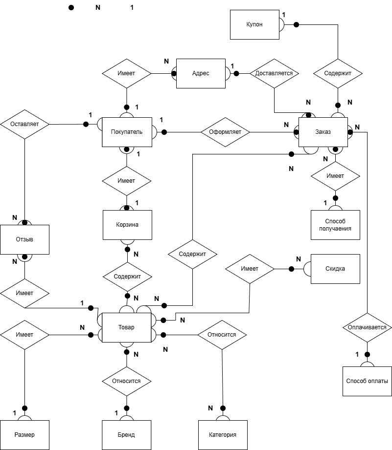
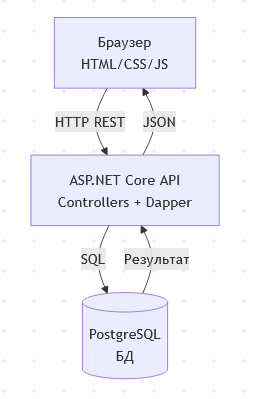
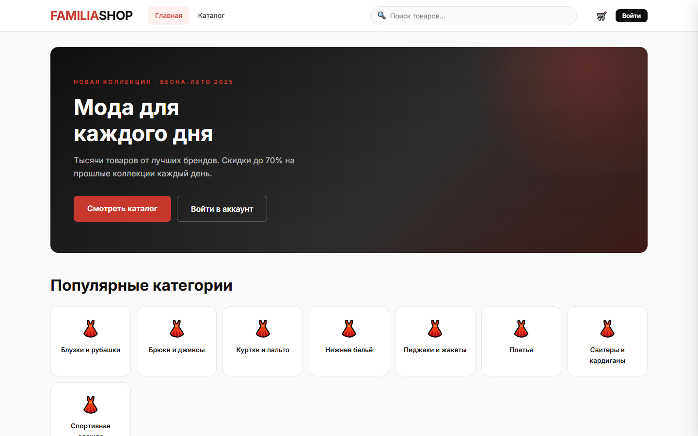
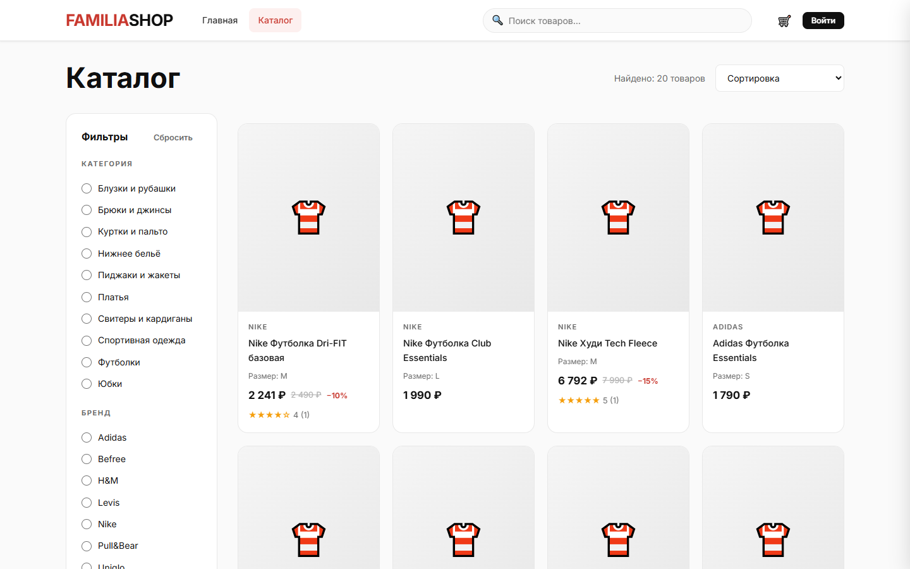
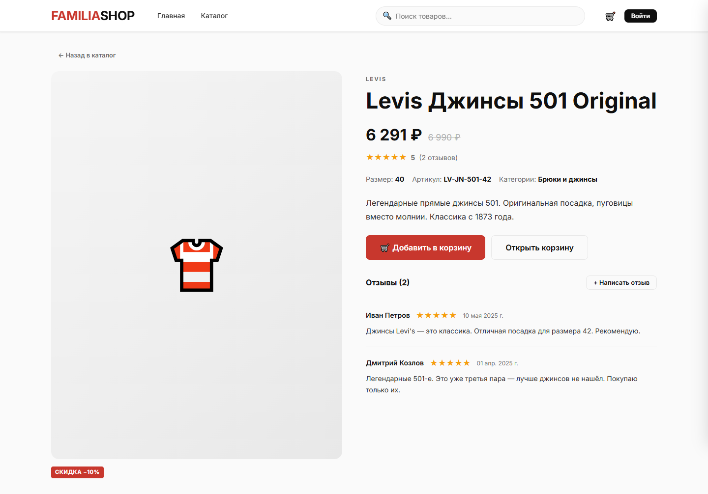
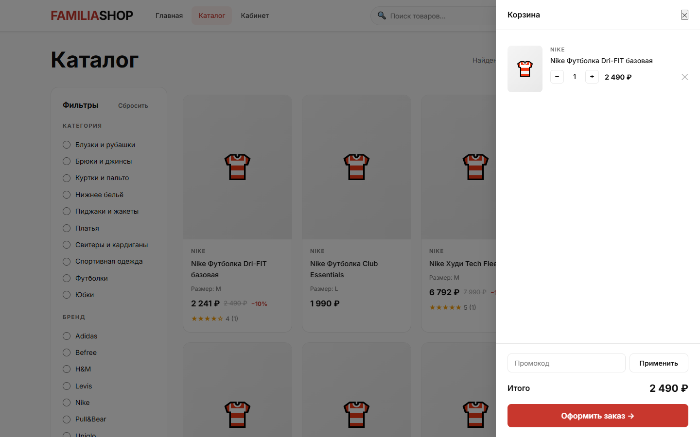
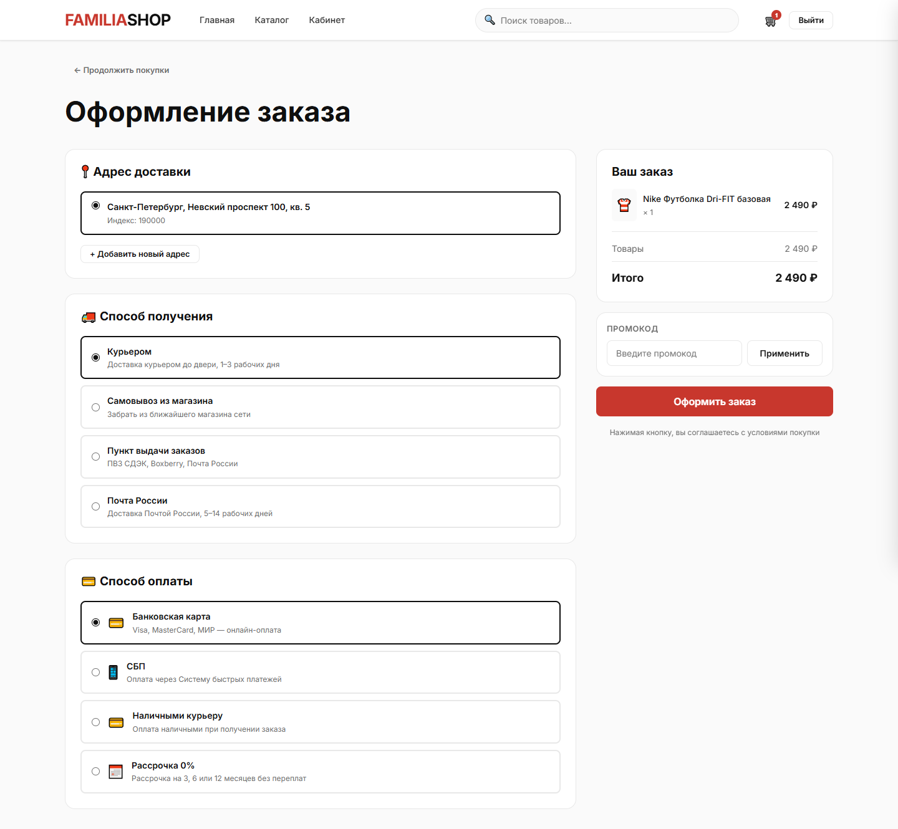
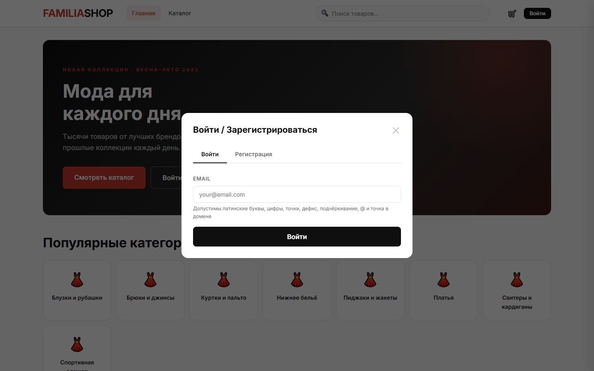
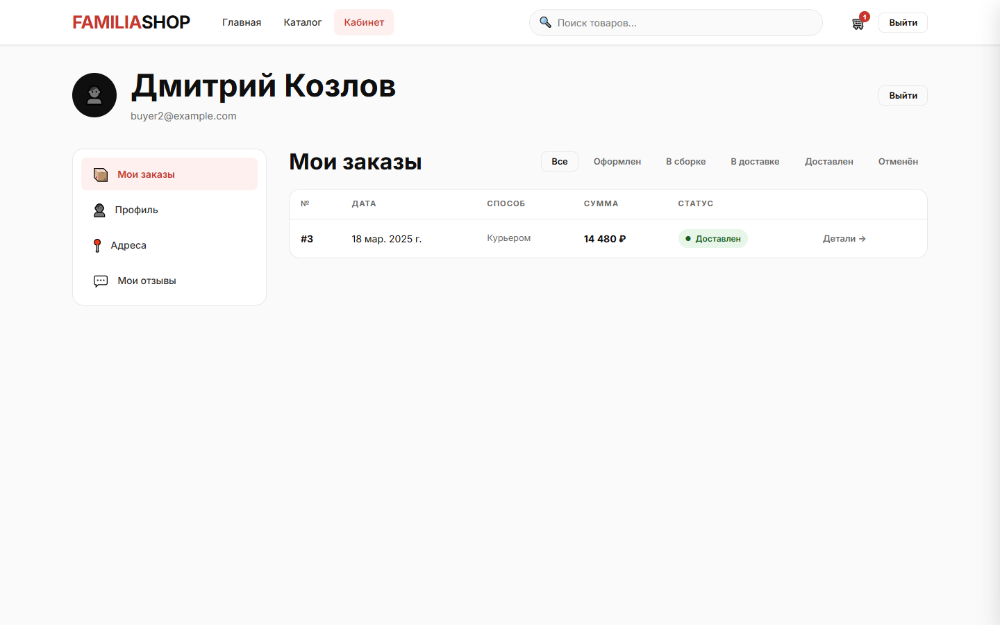
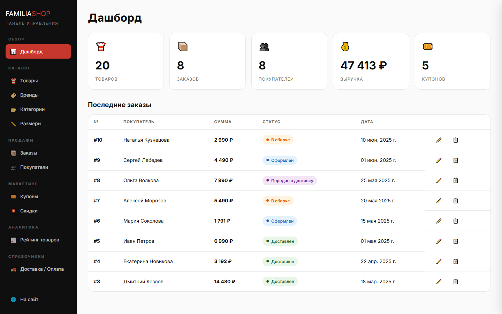

# FamiliaShop

Курсовой проект по дисциплине «Клиент-серверные приложения баз данных».

Онлайн-магазин одежды с клиент-серверной архитектурой: REST API на ASP.NET Core, база данных PostgreSQL и клиентская часть на HTML/CSS/JavaScript.

## Возможности

- каталог товаров с фильтрами по бренду, категории, размеру, цене и поиском;
- карточка товара с рейтингом и отзывами;
- корзина: добавление, изменение количества и удаление товаров;
- оформление заказа с выбором адреса, способа получения и способа оплаты;
- промокоды и скидки на товары;
- история заказов и журнал смены статусов;
- личный кабинет: профиль, адреса, заказы и отзывы;
- панель администратора: товары, заказы, покупатели, купоны, скидки и статистика продаж.

Авторизация упрощённая: вход выполняется по email, без пароля.

## Стек

- .NET 9, ASP.NET Core Web API;
- C#, Dapper, Npgsql;
- PostgreSQL 15+ (проект проверен на PostgreSQL 16);
- HTML5, CSS3, JavaScript без фреймворков.

## Структура проекта

```text
FamiliaShop.API/
├── Controllers/            REST-контроллеры
├── DTOs/                   объекты передачи данных
├── Data/                   подключение к PostgreSQL
├── wwwroot/                клиентская часть
│   ├── css/
│   ├── fonts/
│   ├── js/
│   └── pages/
├── database/
│   ├── db_objects.sql      создание объектов БД
│   └── db_setup.sql        демонстрационные данные
├── docs/
│   ├── screenshots/        скриншоты и схемы
│   └── Курсовая_КСПБД_Писецкий_М_А.pdf
├── appsettings.example.json
├── FamiliaShop.API.csproj
├── FamiliaShop.API.http
└── Program.cs
```

## Требования

- .NET SDK 9.0;
- PostgreSQL 15 или выше;
- pgAdmin или psql (необязательно).

## Запуск

1. Создать базу данных `familia_shop`.

```bash
createdb -U postgres familia_shop
```

2. Создать объекты БД и загрузить демонстрационные данные.

```bash
psql -U postgres -d familia_shop -f database/db_objects.sql
psql -U postgres -d familia_shop -f database/db_setup.sql
```

Скрипты нужно выполнять от имени суперпользователя: `db_setup.sql` временно отключает триггеры.

3. Скопировать пример конфигурации и указать пароль PostgreSQL.

```bash
cp appsettings.example.json appsettings.json
```

4. Запустить приложение.

```bash
dotnet restore
dotnet run
```

Приложение будет доступно по адресу `http://localhost:5292`.

## База данных

База данных содержит 20 таблиц, 3 представления, 3 правила, 5 триггеров и 3 хранимые процедуры.

Основные серверные объекты:

- представления `v_Каталог`, `v_ЗаказыПолные`, `v_РейтингТоваров`;
- процедуры `sp_ДобавитьТовар`, `sp_ОбновитьПокупателя`, `sp_ОформитьЗаказ`;
- триггеры `trg_АвтоКорзина`, `trg_ЛогСтатусов`, `trg_ПереносКорзиныВЗаказ`, `trg_ПересчётИтогаЗаказа`;
- правила `rule_ЗапретВставкиВЗаказы`, `rule_ЗапретУдаленияИзКаталога`, `rule_ОбновлениеЦеныЧерезКаталог`;
- домен `email_type` для проверки формата email.

Схема базы данных:



Схема архитектуры:



## API

| Метод | Путь | Назначение |
|---|---|---|
| GET | `/api/products` | каталог с фильтрами `brand`, `kategoria`, `razmer`, `minPrice`, `maxPrice`, `search` |
| GET | `/api/products/{id}` | карточка товара |
| GET | `/api/products/stats` | статистика продаж и рейтинга |
| GET | `/api/buyers/email/{email}` | поиск покупателя по email для входа |
| GET | `/api/buyers/{id}/addresses` | адреса покупателя |
| GET | `/api/cart/{buyerId}` | содержимое корзины |
| POST | `/api/cart/{buyerId}/items` | добавить товар в корзину |
| PUT | `/api/cart/{buyerId}/items/{tovarId}` | изменить количество товара |
| DELETE | `/api/cart/{buyerId}/items/{tovarId}` | удалить товар из корзины |
| GET | `/api/orders` | список заказов |
| GET | `/api/orders/{id}` | заказ с составом |
| POST | `/api/orders` | оформить заказ из корзины |
| GET | `/api/orders/{id}/log` | история статусов заказа |
| GET | `/api/reviews/product/{productId}` | отзывы о товаре |
| POST | `/api/reviews` | добавить отзыв |
| GET | `/api/coupons/validate/{code}` | проверить промокод |
| GET | `/api/references/brands` | список брендов |
| GET | `/api/references/categories` | список категорий |
| GET | `/api/references/sizes` | список размеров |
| GET | `/api/references/delivery-methods` | способы получения |
| GET | `/api/references/payment-methods` | способы оплаты |
| GET | `/api/discounts` | список скидок |

Примеры запросов находятся в файле `FamiliaShop.API.http`.

## Тестовые данные

В репозитории используются обезличенные демонстрационные данные: 20 товаров, 8 покупателей, 8 заказов и 11 отзывов.

Вход в личный кабинет:

```text
buyer2@example.com
```

Промокод:

```text
FAMILIA10
```

Промокод даёт скидку 10% на заказ.

## Скриншоты

Главная страница:



Каталог товаров:



Карточка товара:



Корзина:



Оформление заказа:



Вход в аккаунт:



Личный кабинет:



Панель администратора:



## Документация

[Пояснительная записка](docs/Курсовая_КСПБД_Писецкий_М_А.pdf)

## Автор

Писецкий М. А., группа 3415.

Рязанский государственный радиотехнический университет имени В.Ф. Уткина, 2026.
